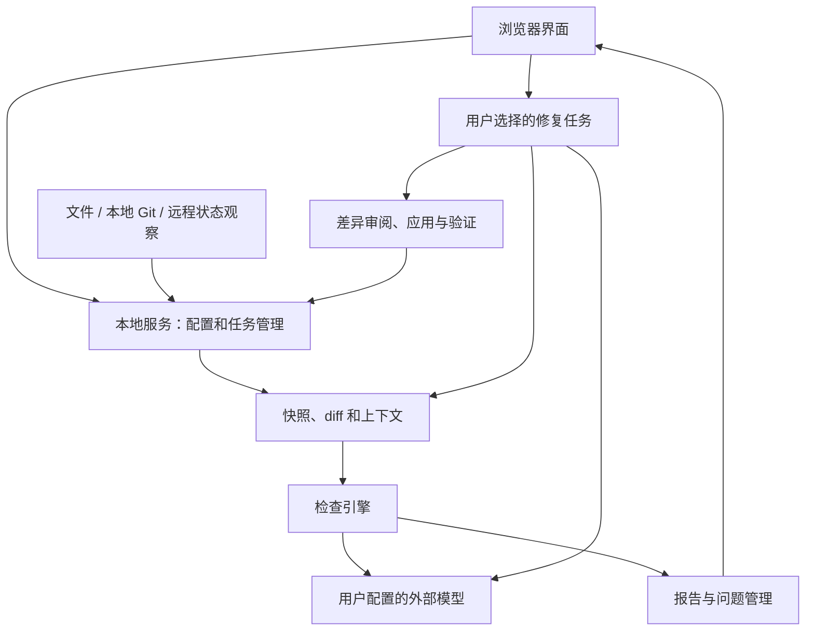

# 巡码（CodeScout）架构设计草案

日期：2026-10-13。状态：待评审草案；不是已批准的实施规格。

依据：[需求文档](../../requirements.md)。本文件细化建议设计，不锁定技术栈、模型厂商、接口协议或数据库，也不代替需求决策。

## 1. 设计目标与约束

以本地后台服务承担持续监控和任务执行，以浏览器承担配置与交互。覆盖工作目录变化、本地 Git 状态变化和远程未拉取的新提交，自动安排检查。外部模型由用户配置，仅发送必要上下文。检测不自行授权修改；修复根据用户选择启动。

建议第一版采用单机部署，以模块分工保持清晰，暂不拆成多个独立网络服务。内部组件能独立验证，便于后续调整实现。

## 2. 运行结构

图中的修复差异确认步骤为推荐方案，尚待用户确认。浏览器关闭不改变服务和任务状态；后台实际停止后，恢复流程负责核对未处理变化。

## 3. 模块职责

| 模块 | 负责什么 | 输出和依赖 |
| --- | --- | --- |
| 项目配置 | 项目根目录、排除范围、约定来源、远程目标、模型配置引用 | 输出项目配置版本；依赖持久化 |
| 变化观察 | 发现文件、本地 Git、远程目标状态差异 | 输出带来源与目标的事件；不直接调用模型 |
| 调度与恢复 | 事件合并、去重、任务排队、重试和恢复 | 输出任务；依赖观察状态、基线及快照 |
| 快照与上下文 | 固定检查对象、计算 diff、取得有效规范及相关文件 | 输出一致的检查输入；不执行修复 |
| 检查引擎 | 规则检查和语义检查，标记覆盖不足 | 输出带证据的检查报告；依赖检查器及模型适配 |
| 模型适配 | 后台读取配置、发送请求、处理限流及超时 | 输出标准化结果与请求状态；不决定问题生命周期 |
| 问题管理 | 关联报告、重复问题、过期及解决状态 | 输出用户可查看的问题和历史 |
| 修复执行 | 依据选择生成修改、核对目标、应用和验证 | 输出差异与验证记录；依赖用户选择和最新文件状态 |

浏览器不持有可直接调用模型或修改任意目录的长期凭据；本地服务只操作已接入并授权的项目范围。

## 4. 核心数据记录建议

| 记录 | 最少需要保存的信息 | 作用 |
| --- | --- | --- |
| Project | 标识、路径、监控状态、配置版本 | 定位已接入项目 |
| Target | 工作目录/本地 Git/远程 Git、分支或远程引用 | 分隔检测目标 |
| Snapshot | 目标标识、提交标识或内容摘要、创建时间 | 固定检查和修复依据 |
| RuleSet | 来源、作用域、版本或内容摘要、冲突 | 复现有效约定 |
| Observation | 最近观察目标、待处理变化、最近核对时间 | 重启后补查与事件去重 |
| CheckRun | 基线及目标快照、规范版本、检查器/模型配置版本、状态、覆盖范围 | 保存一次完整检查的证据 |
| Finding | 类型、位置、依据、严重程度、目标及状态 | 展示并追踪问题 |
| RepairRun | 问题选择、源快照、授权范围、修改差异、应用及验证状态 | 追踪修复过程 |

远程目标和本地工作目录中的相似问题可以关联展示，但不能因为本地已修复就宣称远程旧提交已改变。

## 5. 自动检测流程

### 5.1 观察与安排

1. 接入后核对当前状态并安排首次检查。
2. 文件事件与本地 Git 变化通知用于及时发现变化；建议周期核对状态来补偿丢失事件。
3. 按用户配置的远程目标后台核对更新；不要求打开网页或执行本地拉取。
4. 同一目标的连续事件合并。检查键建议包含目标快照、规范版本、检查配置版本。
5. 新状态在旧任务运行期间出现时，安排后续任务，并清楚标记旧报告对应的时间和目标。

观察到新状态与检查成功必须分开记录。检查失败后不能把观察位置当成已完成的检查基线，从而跳过尚未检查的变化。

### 5.2 固定快照与比较

工作目录检查包括适用范围内的未提交文件和未跟踪文件；排除规则单独生效，不假设所有忽略文件都应发送给模型。读取中出现继续修改时重试或延期，不能将不一致内容报告为稳定快照。

本地提交和远程提交按目标分开建立基线。远程检查需要取得目标内容的独立快照，不切换或合并用户当前目录。具体取得方式留给技术方案确定。

首次观察远程目标时建议检查其有效范围；后续比较此前目标与新目标。历史改写或无可用基线时扩大检查并说明原因。是否逐条处理全部中间提交尚待确认；当前设计不承诺逐提交审计。

### 5.3 上下文与检查

从 diff 找到受影响对象，再读取有效约定、相关实现、调用位置、注释和文档。关联方法可能由解析器、搜索和模型辅助组成，具体语言支持待确定。每次任务记录实际读取和检查范围。

模型上下文不足时采用明确的分批或降级策略，并标记未覆盖部分。模型输出经过格式、文件位置和证据引用核对，再形成报告；无法定位的结论不得伪装成精确问题位置。

### 5.4 结果更新

完成报告保存后更新问题状态和成功检查基线。部分完成的任务需要保留未完成范围，不能将整体视为已通过。重复问题按目标、规则、对象和证据关联，具体身份策略需用重命名和行号移动样例验证。

## 6. 规范生效建议

检查快照内的约定取自该快照，外部配置单独版本化。自然语言文档用于明确规范，并保留原始来源；不把仓库里的任意文本当成扩大修复权限的指令。

规范优先级、子目录继承和冲突规则尚未确认。实现前必须决定这些行为。约定发生变化时，重新检查其有效作用域；无法可靠确定受影响范围时，建议检查该作用域全部有效文件，并说明范围扩大。

## 7. 修复流程建议

推荐默认流程：选择问题及修复目标 → 固定源快照和授权范围 → 生成差异 → 用户查看并应用 → 核对当前文件状态 → 应用修改 → 执行配置的验证 → 复查问题。

用户也可以选择启动时授权指定范围内的直接修改；该方式尚未确认，不能提前作为默认行为写入实现。

远程问题与当前分支不一致时，需要明确选择修复目标；推荐在独立工作区生成差异。创建分支、提交、推送和合并策略未确定，第一版不默认自动执行这些操作。

应用修改时核对源内容；不一致则停止应用并重新生成或展示冲突。多文件应用中途失败时保存已应用范围和恢复依据，不报告为全部成功。恢复操作本身也必须核对后续编辑，避免覆盖用户新工作。

验证命令来自用户明确配置的流程。没有运行验证、验证失败或环境不满足时，显示准确状态。测试通过与规范问题已解决是不同结论，需要分别记录。

## 8. 状态、异常与恢复

检查任务建议采用：等待、运行中、完成、部分完成、失败、取消、被新快照替代。项目监控状态和单个任务状态分别保存；单次检查失败不等于停止整个项目监控。

| 情况 | 处理建议 |
| --- | --- |
| 断网或远程认证失败 | 显示远程暂不可检查，本地仍继续；恢复后核对远程 |
| 模型超时、限流或配置失效 | 有限重试，保留失败状态及未完成范围 |
| 项目目录消失或读取失败 | 暂停该目标并显示原因，不删除历史记录 |
| 服务运行中断 | 恢复时核对任务产物及最新状态，避免重复应用修复 |
| 同一变化重复出现 | 依据任务键去重；强制复查另有明确记录 |
| 历史改写或分支变化 | 核对基线适用性，必要时重建并扩大检查 |
| 模型输出无法验证 | 保存未完成原因，不静默应用无效差异 |

任务持久化必须使任务状态与产物能够一致恢复；具体存储事务和文件落地策略属于后续技术设计。

## 9. 外部模型与访问边界

外部模型地址、模型标识和凭据由用户配置。后台集中处理请求，浏览器只展示脱敏配置。建议设置超时、并发和请求预算，达到限制时显示等待或暂停原因，避免无限重试。

按项目排除项和本轮需要构造上下文，记录发送文件范围和配置版本。凭据、访问令牌等敏感配置不得进入模型上下文、报告和普通日志。外部模型请求失败不妨碍保留已完成的确定性检查结果。

本地服务默认只对本机开放；配置和修改接口需要访问保护。具体机制随运行方式确定，暂不支持其他设备远程管理。

## 10. 验证设计

使用需求 AC-01～14 作为验收基础，重点覆盖三类自动触发、模型故障、读取中变化、规范更新、服务恢复和修复冲突。

建议准备小型示例仓库：函数行为变化但文档未更新、分支中规范不同、连续保存、远程更新和历史改写。通过可控模型替身验证流程，再用人工标注样例评估实际语义检查质量。后台测试必须能在没有网页打开时验证任务产生。

## 11. 评审前待决策

- Agent 修复确认方式以及远程问题修复目标。
- 操作系统、语言、Git 平台及模型接口范围。
- 约定继承和优先级、上下文关联方式。
- 远程核对周期、通知方式、逐提交审计范围。
- 项目规模、并发预算、结果保留和质量目标。

这些决策确定并通过书面设计评审后，再编写具体实施计划。当前文档可以用于讨论与修订，不能视为已批准进入编码。
